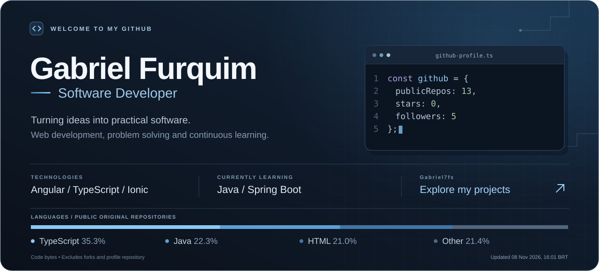

  

  Software development, practical solutions and continuous learning. 
  Explore my projects, technologies and development journey below.

  <a href="https://github.com/Gabriel7fs?tab=repositories"><strong>Explore my projects →</strong></a>

<!-- PROFILE-CONTENT:START -->

## Skills & experience

| Area | Technologies |
| --- | --- |
| Web development | HTML5, CSS3, TypeScript and Angular |
| Mobile development | Ionic |
| Programming | C |
| Relational databases | MySQL and PostgreSQL |
| Version control | Git and GitHub |

## Technology stack

## Tools

## Databases

## Development environments

## Currently learning

## GitHub activity

**13 public repositories** · **0 stars on original public repositories** · **5 followers**

Language percentages represent code bytes in original public repositories. Forks and the profile repository are excluded from the language chart.

<!-- PROFILE-CONTENT:END -->
